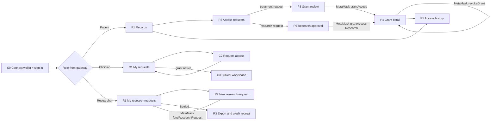

# CareConsent Frontend — Screen Flow, Wireframes and UI State Rules

- **Module:** Patient dashboard and access history (Epic E5)
- **Owner:** Elif Naz Akdora · **Second member:** Enes Malik Çolak
- **Process:** P05 Design definition
- **Status:** Draft for team review. Screens marked *implemented* exist in `frontend/` (PRs from `feat/frontend-setup` and `feat/wallet-auth`); all others are designs.

**Ownership boundary.** These screens only *consume* other modules. The contracts and their rules belong to E3/E6 (Hasan Samet Yurtbilir). Challenge issuance and verification, consent enforcement, storage and receipts belong to the gateway in E2 (Bahattin Baran Serin). The five query templates and their results belong to E4 (Ayset Mammadova). Acceptance scripts belong to Enes Malik Çolak. Where an API does not exist yet, the frontend uses clearly labelled mock data and never fills in gateway decisions itself.

**Sources:**
- `proposal/CareConsent_Patient-Controlled_Health_Data_and_Aud_proposal.json`: stories S1–S12, `model_User_interface`, `model_Interaction`, `model_Security`, scenarios, DoD
- `docs/contract-interface.md`: contract functions, enums, expiry rule, privacy invariants
- `contracts/abi/*.json`: function, event and custom-error names

---

## 1. Design principles

1. **A screen state must match an enforced decision.** The UI shows only what is confirmed on chain or returned by the gateway. It never shows a grant as active before its transaction is confirmed.
2. **Five result states are always visually distinct:** *result*, *empty* (valid answer, nothing matched), *denied* (no permission), *unavailable* (dependency failure, safe to retry), *integrity failure* (object rejected). They never share a message or colour (S7, S12, Scen_Absent).
3. **Honest limits.** Revocation stops future gateway releases only. A receipt records an authorised release attempt, not proof that a person read the data. The UI says both wherever they matter (S4, S8).
4. **No sensitive data in the browser beyond what the user is allowed to see.** Raw CIDs, keys and plaintext patient identifiers are never displayed, logged or put in URLs. Health fields appear only after permission is active (S5).
5. **Wallet signatures are explicit.** Every MetaMask prompt is preceded by a screen that says in plain words what will be signed and what it does.
6. **Keyboard and mobile.** Every control is a native button, link or input with a visible focus ring. Layouts collapse to one column below 680 px.

---

## 2. Roles and screen map

| Role | Account (Anvil, demo) | Screens |
|---|---|---|
| Patient | #2 | P1 Records · P2 Access requests · P3 Grant review · P4 Grant detail · P5 Access history · P6 Research approval |
| Clinician | #3 | C1 My requests · C2 Request access · C3 Clinical workspace |
| Researcher | #4 | R1 My research requests · R2 New research request · R3 Export and credit receipt |

All roles share **S0 Sign-in** and the top bar.



---

## 3. Shared elements

### 3.1 Top bar and sign-in (S0) — *implemented (wallet-auth PR)*

```
┌──────────────────────────────────────────────────────────────────────────────────┐
│ CareConsent   [Synthetic demo data]  (● 0x3C44…93BC  Patient) [Sign in] Disconnect │
├──────────────────────────────────────────────────────────────────────────────────┤
│ ⚠ Wrong network: MetaMask is on chain 1. CareConsent uses Anvil (local)          │
│   (chain 31337). Signing in is disabled until you switch.  [Switch to Anvil]     │
└──────────────────────────────────────────────────────────────────────────────────┘
```

| Wallet state | Top bar shows |
|---|---|
| No MetaMask | "MetaMask not detected" + [Install MetaMask] |
| Not connected | [Connect wallet] |
| Connected, wrong chain | address badge with amber dot, [Sign in] disabled, warning bar with [Switch to Anvil] |
| Connected, right chain | address badge with green dot + role, [Sign in] |
| Waiting for signature | [Waiting for signature…] disabled |
| Signed in | address badge + "Signed in" (+ "· mock check" while the gateway is missing) + [Sign out] |
| Any connected state | [Disconnect]: forgets the account and asks MetaMask to revoke the site permission (`wallet_revokePermissions`) |

Rules:
- The sign-in message is EIP-4361 style and bound to domain, account, chain id, one-time nonce and a 5-minute expiry. It states that it sends no transaction and shares no data.
- The challenge must be issued and verified by the gateway (E2). Until its endpoints exist, the frontend checks the signature in the browser and labels the session "mock check". That proves the flow works, not the user's identity.
- Changing account or chain in MetaMask ends the session immediately. A sign-in that completes after such a change is discarded.
- A rejected MetaMask prompt shows "The request was rejected in MetaMask." It is not shown as a system error.

**Page access after sign-in** (*implemented, wallet-auth PR*). A role page loads data only for a viewer who may see it:

| Viewer | Patient records page shows |
|---|---|
| Not signed in | Sign-in card with the three steps; in mock mode an optional, clearly labelled synthetic preview |
| Signed in as the record owner | Records, versions and selection (P1) |
| Signed in with another account (clinician, researcher, …) | Access-denied state: "You are signed in as Clinician. This page shows a patient's own records only." No records are loaded |

The role label comes from the Anvil account convention while the gateway is missing. The owner check compares the signed-in address with the record owner, not the role label.

### 3.2 Result-state components (S12) — *empty, unavailable, denied and loading implemented*

```
┌ Empty ───────────────────────────────┐  ┌ Service unavailable ─────────────────────┐
│ ○  No records yet                     │  │ !  Service unavailable                    │
│    This is not an error: ...          │  │    ... This is a system problem, not an   │
└───────────────────────────────────────┘  │    empty health history. No clinical      │
                                           │    content was released.  [Try again]     │
┌ Access denied ───────────────────────┐  └───────────────────────────────────────────┘
│ ⛔ Access not permitted               │  ┌ Integrity check failed ──────────────────┐
│    Your grant is revoked / expired /  │  │ ✕  A record failed its integrity check    │
│    does not cover this record.        │  │    and was not shown. Nothing partial was │
└───────────────────────────────────────┘  │    released. Report it to the patient.    │
                                           └───────────────────────────────────────────┘
```

| State | Colour / icon | ARIA | Retry? | Wording rule |
|---|---|---|---|---|
| Loading | neutral spinner | `role="status"` | — | "Loading …" |
| Empty | grey ○ | `role="status"` | no | Says "not an error" and names the scope that was searched |
| Denied | red ⛔ | `role="alert"` | no | Names the reason: missing, revoked, expired, other recipient, other purpose, version not in scope |
| Unavailable | red ! on tinted panel | `role="alert"` | yes | Says "system problem, not an empty history" and "no clinical content was released" |
| Integrity failure | red ✕ | `role="alert"` | no | Says the object was rejected and nothing partial was released |

### 3.3 Transaction progress (all MetaMask transactions) — *shared helper implemented (`runTransaction`), used by the grant screens next*

```
[ Review ] → [ Confirm in MetaMask ] → [ Waiting for confirmation… ] → [ Confirmed ✓ ]
                    │ rejected                      │ reverted
                    ▼                               ▼
             "You rejected the request."    "The contract refused: <mapped custom error>"
```

- The UI changes the displayed state only after the transaction receipt is confirmed. Until then it shows "Waiting for confirmation" with the transaction hash.
- Custom errors from the ABIs are mapped to plain text. For example, `GrantAlreadyExpired` → "This grant has already expired; there is nothing to revoke." and `ExpiryNotInFuture` → "Choose an expiry time in the future."
- A send failure that is neither a rejection nor a contract error is shown as "could not be sent" (failed), not as a contract refusal.

### 3.4 Network & contracts panel — *implemented (wallet-auth PR)*

```
┌ ▸ Network & contracts   [Anvil (local) · block 42] ──────────────────────┐
│ Chain time      25 Nov 2026, 14:00 UTC (used for grant expiry)           │
│ Your balance    10000.0000 ETH · 1000 test credits                        │
│ RecordRegistry      0x5FbD…0aa3  [deployed]                              │
│ ConsentManager      0xe7f1…0512  [deployed]                              │
│ ResearchSettlement  0x9fE4…a6e0  [no code]                               │
│                                                         [Refresh]        │
└───────────────────────────────────────────────────────────────────────────┘
```

| Check result | Badge | Panel |
|---|---|---|
| Chain reachable, all three contracts have code | green "Anvil (local) · block N" | collapsed |
| A contract has no code at its configured address | red "Contracts missing" | opens itself; says to deploy or set the addresses in `.env.local` |
| MetaMask cannot reach the chain | red "Chain not reachable" | opens itself; says to start `anvil` |

- Shown only when a wallet is connected on the expected chain. Reads go through MetaMask's own connection, so they reflect the chain the wallet signs on.
- Chain time is the latest block timestamp. Expiry display and checks (P4, C1) use it, never the browser clock.
- Contract ABIs come from `contracts/abi/`; addresses come from `.env.local`, or default to the first deployment on a fresh Anvil.

---

## 4. Patient screens

### P1 Records and version selection — *implemented with mock data (frontend-setup PR)*

```
┌─────────────────────────────────────────────────────────────────────────────────────────┐
│ My health records                                          [Records|Empty|Service error] │
│ Synthetic patient P01 · records you own and the versions you can choose to share.        │
├──────────────────────┬──────────────────────────────────────────┬────────────────────────┤
│ CONDITION            │ MEDICATION  Amoxicillin course           │ Selected versions (2)  │
│ Type 2 diabetes      │ Select the exact versions to share ...   │            [Clear]     │
│ 2 versions · Jun 25  │ ┌──────────────────────────────────────┐ │ Amoxicillin · v2  Rem. │
│──────────────────────│ │☑ Version 2  [Current]  completed     │ │ Metformin   · v2  Rem. │
│▌MEDICATION           │ │  Corrected: course taken 27 Jan ...  │ │ ────────────────────── │
│▌Amoxicillin course   │ │  Recorded 05 Feb 2026 · Clinic A     │ │ Scope commitment:      │
│▌2 versions [1 sel.]  │ │  Registered ... · ID 0x8f2a…41c0     │ │ 0x4be1c9d0…7a3e19f2    │
│──────────────────────│ ├──────────────────────────────────────┤ │                        │
│ ALLERGY              │ │☐ Version 1  [Superseded] completed   │ │ Choosing a recipient,  │
│ Sulfonamide ...      │ │  ⚠ A later correction exists ...     │ │ purpose and expiry     │
│ ...                  │ └──────────────────────────────────────┘ │ comes next.            │
└──────────────────────┴──────────────────────────────────────────┴────────────────────────┘
```

- Version lifecycle badges: **Current**, **Superseded** (a correction exists; selectable, with a warning), **Retired** (disabled checkbox; the earlier on-chain commitment is kept) (S11).
- The scope commitment preview uses `keccak256(abi.encode(patient, sortedVersionIds))`, so the patient can match it later with the grant on chain.
- States: loading, empty ("No records yet … not an error"), unavailable (with retry).

### P2 Access requests (inbox)

```
┌──────────────────────────────────────────────────────────────────────────┐
│ Access requests                                                          │
│ ┌──────────────────────────────────────────────────────────────────────┐ │
│ │ Dr. Clinician (0x90F7…b906) · Treatment · 3 versions · until 30 days │ │
│ │ Requested 25 Nov 2026                     [Review]  [Refuse]         │ │
│ ├──────────────────────────────────────────────────────────────────────┤ │
│ │ Research group (0x15d3…6A65) · Research · fee 50 credits · funded    │ │
│ │ Requested 25 Nov 2026                     [Review terms]             │ │
│ └──────────────────────────────────────────────────────────────────────┘ │
│ Empty: "No pending requests."                                            │
└──────────────────────────────────────────────────────────────────────────┘
```

- A treatment refusal is an off-chain gateway action and needs no transaction. A research refusal calls `refuseResearchRequest(requestId)`, which refunds the researcher's fee on chain.

### P3 Grant review and confirmation (S3)

```
┌───────────────────────────────────────────────────────────────┐
│ Share records with a clinician                                │
│ Recipient   Dr. Clinician · 0x90F7…b906 (full address on hover) │
│ Purpose     Treatment                                         │
│ Versions    ☑ Amoxicillin course v2   ☑ Metformin v2   ☑ HbA1c v2 │
│             (requested versions; you may untick, not add)     │
│ Expiry      (•) 30 days  ( ) 7 days  ( ) 1 day  ( ) custom    │
│             Ends 25 Dec 2026 14:00 UTC (chain time)           │
│ Scope commitment 0x4be1…19f2                                  │
│                                                               │
│ What happens: MetaMask asks you to sign grantAccess. Only     │
│ this recipient, purpose and version list are allowed until    │
│ the expiry. You can revoke it earlier.                        │
│                                   [Cancel]  [Confirm in MetaMask] │
└───────────────────────────────────────────────────────────────┘
```

- Calls `ConsentManager.grantAccess(grantId, grantee, Purpose.Treatment, scopeCommitment, expiresAt)`.
- Expiry presets include 30 days for the demo. `expiresAt` must be later than the latest block time, otherwise the contract reverts with `ExpiryNotInFuture`.
- The patient may remove requested versions but cannot add unrequested ones. Adding versions needs a new request.

### P4 Grant detail and revoke (S4)

```
┌───────────────────────────────────────────────────────────────┐
│ Grant 0x7c1e…aa02                               [Active]       │
│ Recipient  Dr. Clinician · 0x90F7…b906                         │
│ Purpose    Treatment       Expires 25 Dec 2026 14:00 UTC       │
│ Versions   Amoxicillin v2 · Metformin v2 · HbA1c v2            │
│ Releases   2 (see access history)                              │
│                                              [Revoke access]   │
└───────────────────────────────────────────────────────────────┘

┌ Revoke access? ───────────────────────────────────────────────┐
│ After the revocation is confirmed, the gateway refuses every  │
│ new request for this grant, including a prepared response     │
│ that has not been released yet.                               │
│                                                               │
│ ⚠ Copies that the recipient already downloaded cannot be      │
│   recalled. Revocation only stops future releases through     │
│   CareConsent.                                                │
│                               [Keep access]  [Revoke in MetaMask] │
└───────────────────────────────────────────────────────────────┘
```

- Calls `ConsentManager.revokeGrant(grantId)`. The badge turns **Revoked** only after confirmation.
- [Revoke access] is shown only for **Active** grants, because the contract rejects expired ones (`GrantAlreadyExpired`) and already revoked ones (`GrantAlreadyRevoked`).
- Earlier receipts stay visible after revocation or expiry.

### P5 Access history and receipt verification (S8)

```
┌────────────────────────────────────────────────────────────────────────────────┐
│ Access history                                                                 │
│ Who received records through the CareConsent gateway, and when.              │
│ ┌────────────┬───────────────┬───────────┬──────────────┬──────────────────┐ │
│ │ Time (UTC) │ Recipient     │ Purpose   │ Versions     │ Chain check      │ │
│ ├────────────┼───────────────┼───────────┼──────────────┼──────────────────┤ │
│ │ 26 Nov 10:02│ Dr. Clinician │ Treatment │ 3 versions   │ ✓ Matches event  │ │
│ │ 27 Nov 09:15│ Dr. Clinician │ Treatment │ 1 version    │ ⚠ Delivery unconfirmed │
│ │ 28 Nov 12:40│ Dr. Clinician │ Treatment │ 3 versions   │ ✕ Does not match │ │
│ └────────────┴───────────────┴───────────┴──────────────┴──────────────────┘ │
│ ⓘ An entry records an authorised release by the gateway. It does not prove   │
│   that a person viewed the data or that it was not shared further. Copies    │
│   already downloaded by a recipient cannot be recalled by revoking access.   │
└────────────────────────────────────────────────────────────────────────────────┘
```

Verification: the browser computes `sha256(encrypted receipt bytes)` and compares it with `ConsentManager.verifyReceiptCommitment(releaseId, commitment)` and the `ReleaseRecorded` event.

| Check result | Badge | Meaning |
|---|---|---|
| Commitment matches a confirmed `ReleaseRecorded` event | ✓ Matches event (green) | Receipt is unchanged |
| Event exists, outcome `delivery-unconfirmed` | ⚠ Delivery unconfirmed (amber) | Anchored, but the response may not have reached the recipient |
| Commitment differs from the event | ✕ Does not match (red) | Receipt was modified; report it |
| No event for `releaseId` | ✕ Not anchored (red) | Release was never confirmed on chain |
| Chain unreachable | Unavailable state | Retry later; not shown as a mismatch |

### P6 Research approval (S9, S10)

```
┌───────────────────────────────────────────────────────────────┐
│ Research request — separate decision                          │
│ This is not treatment access. A treatment grant can never     │
│ authorise this export.                                        │
│                                                               │
│ Researcher  Research group · 0x15d3…6A65                      │
│ Purpose     Study of medication adherence in type 2 diabetes  │
│ Fields      medication name, period, status                   │
│             (excluded: direct identifiers)                    │
│ Versions    Metformin v2 · HbA1c v2                           │
│ Until       10 Dec 2026 00:00 UTC                             │
│ Fee         50 test credits (valueless, funded ✓)             │
│                                                               │
│ If you approve, you receive 50 test credits once, after the   │
│ gateway releases the export.                                  │
│                 [Refuse (refund researcher)]  [Approve in MetaMask] │
└───────────────────────────────────────────────────────────────┘
```

- Approve calls `grantAccess(…, Purpose.Research, scopeCommitment, expiresAt)`. The scope must equal the funded request's `scopeCommitment`.
- Refuse calls `ResearchSettlement.refuseResearchRequest(requestId)`.
- After settlement the patient sees the credit in their balance (`creditBalances`) and a **Settled** status.

---

## 5. Clinician screens

### C1 My requests and status (S5)

```
┌──────────────────────────────────────────────────────────────────────┐
│ My access requests                                  [Request access] │
│ ┌──────────────────────────────────────────────────────────────────┐ │
│ │ Patient P01 · Treatment · 3 versions    [Pending]                │ │
│ │ Patient P01 · Treatment · 3 versions    [Active · until 25 Dec]  │ │
│ │                                          [Open workspace]        │ │
│ │ Patient P02 · Treatment · 1 version     [Refused]                │ │
│ │ Patient P03 · Treatment · 2 versions    [Expired]                │ │
│ │ Patient P04 · Treatment · 2 versions    [Revoked]                │ │
│ └──────────────────────────────────────────────────────────────────┘ │
└──────────────────────────────────────────────────────────────────────┘
```

| Status | Source | Health fields shown? | Action |
|---|---|---|---|
| Pending | gateway (off-chain request) | No | Wait / cancel |
| Refused | gateway (off-chain request) | No | New request |
| Active | `getGrantStatus` = Active | Only through the workspace | [Open workspace] |
| Expired | `getGrantStatus` = Expired (`now >= expiresAt`, chain time) | No | New request |
| Revoked | `getGrantStatus` = Revoked (takes precedence) | No | New request |

- Status responses and network payloads must contain no health fields before the grant is active (S5 test).

### C2 Request access

Fields: patient (by opaque patient reference from the gateway), versions offered by the gateway's request flow, purpose fixed to Treatment, requested duration (presets 1, 7 and 30 days). Submitting creates an off-chain request (Pending). No transaction is needed.

### C3 Clinical workspace (S6, S7)

```
┌────────────────────────────────────────────────────────────────────────┐
│ Patient P01 · grant active until 25 Dec 2026                           │
│ Template [Antibiotic use, previous 12 months ▾]                         │
│ Interval [2025-12-01] – [2026-12-01) UTC                [Run]          │
├────────────────────────────────────────────────────────────────────────┤
│ Amoxicillin 500 mg · 27 Jan – 02 Feb 2026 · completed                  │
│   source: MedicationStatement v2 (0x8f2a…41c0) · receipt 0x51d0…e2      │
│ ── Recorded use; a prescription alone is not shown as confirmed use ── │
└────────────────────────────────────────────────────────────────────────┘
```

- Only five reviewed templates are offered; there is no free SPARQL input.
- Each result shows the evaluated interval and its supporting source versions.
- Distinct states: *no matching records in this interval* (empty), *grant revoked/expired* (denied), *storage or chain unavailable* (unavailable), *record failed integrity check* (integrity failure).

---

## 6. Researcher screens

### R1 My research requests

Lists requests with `RequestStatus`: Funded, Refused, Settled, Refunded and Expired. For an Expired request it offers [Refund] (`refundExpiredRequest`). It also shows the researcher's test-credit balance.

### R2 New research request

```
┌───────────────────────────────────────────────────────────────┐
│ New research request                                          │
│ Study purpose  [________________________________________]     │
│ Patient        [P01 ▾]   Versions [select offered versions]   │
│ Fields         ☑ medication  ☑ period  ☐ free-text notes      │
│ Until          [10 Dec 2026]                                  │
│ Fee            [50] test credits   Balance: 1000              │
│ MetaMask will move the fee into escrow (fundResearchRequest). │
│ It is refunded if the patient refuses or the request expires. │
│                                   [Cancel]  [Fund in MetaMask] │
└───────────────────────────────────────────────────────────────┘
```

- Errors are mapped from `InsufficientTestCredits`, `ExpiryNotInFuture` and `InvalidFee`.

### R3 Export and credit receipt

Shows the approved export projection, the `releaseId`, and the `ResearchSettled` event (fee, patient, time). A duplicate settlement attempt shows "Already settled for this release" (`ReleaseAlreadySettled`), not an error page.

---

## 7. UI state rules (summary)

| Rule | Story | Where |
|---|---|---|
| Revoke dialog says copies already downloaded cannot be recalled; badge changes only after confirmation | S4 | P4 |
| Request status shows Pending / Refused / Active / Expired / Revoked without health fields before Active | S5 | C1 |
| Expired means `chainTime >= expiresAt`; the UI uses the latest block time, not the browser clock | S3, Scen_Boundary | P4, C1 |
| Receipt is checked against the on-chain commitment; mismatch, not anchored and unavailable are different badges; no claim of human viewing | S8 | P5 |
| Research approval is a separate screen with purpose, fields, versions, expiry and fee; a treatment grant is never offered as a substitute | S9 | P6 |
| Fee is credited once; a repeat shows "already settled" | S10 | P6, R3 |
| A correction is a new version and must be selected explicitly; retired versions cannot be selected | S11 | P1, P3 |
| Empty, denied, unavailable and integrity failure are separate components with separate wording | S7, S12 | all lists and results |
| Wrong network blocks sign-in and transactions until switched | — | top bar |
| A role page loads data only for an allowed signed-in viewer; others get the denied state | S5, DoD | all role pages |
| Missing contracts or an unreachable chain are reported before any transaction is offered | S12 | Network & contracts |

---

## 8. Traceability

| Screen | Stories | Contract calls (ABI) | Gateway API (to be agreed) |
|---|---|---|---|
| S0 Sign-in, Network & contracts | — | `ResearchSettlement.creditBalances` (read); contract code check | challenge, verify, role |
| P1 Records | S1, S2, S11 | `RecordRegistry.getVersion`, `verifyDigest` | list records/versions |
| P2 Requests | S3, S9 | `ResearchSettlement.getRequest`, `refuseResearchRequest` | list requests, refuse treatment request |
| P3 Grant review | S3 | `ConsentManager.grantAccess` | request detail |
| P4 Grant detail | S4 | `getGrant`, `getGrantStatus`, `revokeGrant` | — |
| P5 History | S8 | `getRelease`, `verifyReceiptCommitment`, `ReleaseRecorded` events | encrypted receipt details |
| P6 Research approval | S9, S10 | `grantAccess` (Research), `refuseResearchRequest`, `creditBalances` | research request terms |
| C1/C2 Requests | S5 | `getGrantStatus` | create/list requests |
| C3 Workspace | S6, S7, S12 | — | run template |
| R1–R3 Research | S9, S10 | `fundResearchRequest`, `refundExpiredRequest`, `getSettlement`, `ResearchSettled` | export |

## 9. Open questions for the backend owner

1. Endpoint paths and JSON shapes for: auth challenge/verify, records and versions, access requests, receipts, query templates and export.
2. How the gateway returns the role of a signed-in account.
3. Error body format that keeps *validation*, *denied*, *no match*, *integrity failure* and *unavailable* distinguishable.
4. How the patient's browser receives encrypted receipt bytes for local verification (P5).
